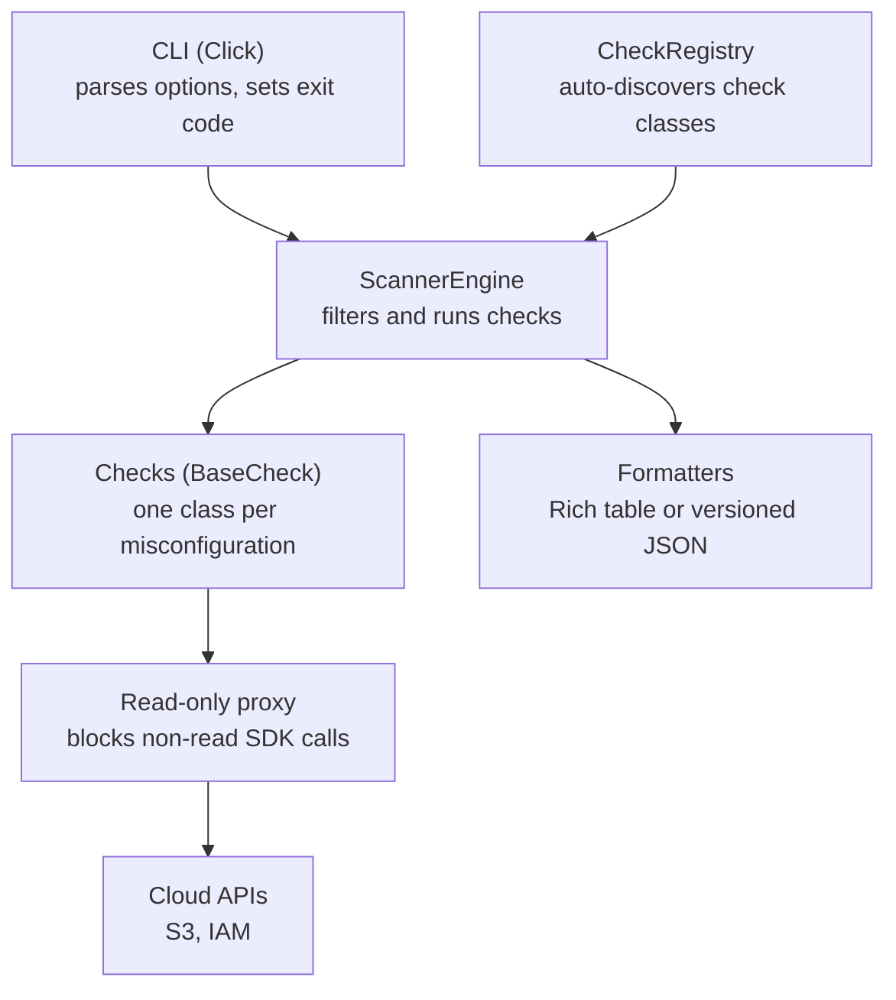

# Cloud Misconfiguration Scanner


A read-only Python CLI that audits cloud accounts for security misconfigurations and tells you exactly how to fix each one.

I built it to automate the issues I found and fixed by hand in my cloud security labs. Each AWS check comes from a control I applied in those labs: public S3 buckets, wildcard IAM policies, missing MFA, and more. Version 0.1 covers AWS S3 and IAM, and the Azure client layer is in place for the checks planned next.

## Read-only by design

A security scanner should be safe to point at a production account, so checks never receive a raw cloud SDK client. They get a proxy that only allows read methods. Anything else fails before a request is sent:

```python
s3 = ReadOnlyAWSClient(region="us-east-1").service("s3")

s3.list_buckets()                # OK
s3.delete_bucket(Bucket="demo")  # raises ReadOnlyViolationError
```

Both proxies are allowlists: AWS clients only allow `describe_`, `get_`, `list_` and `head_` methods, and Azure clients only allow `get` and `list` methods. This protects against mistakes in check code, but it is not a security boundary, so run the scanner with a [read-only IAM identity](#least-privilege-iam-policy) as well.

## What it detects

| Check ID | Severity | What it finds | Lab control it automates |
|---|---|---|---|
| `AWS-S3-001` | Critical | Bucket policy with a public or wildcard principal | Lock bucket policies to specific IAM principal ARNs |
| `AWS-IAM-001` | Critical | IAM policy allowing `Action: *` on `Resource: *` | Scope policies to specific actions and resource ARNs |
| `AWS-IAM-002` | High | IAM user with console access but no MFA | Require MFA for all console users |
| `AWS-S3-002` | Medium | Bucket versioning disabled or suspended | Enable versioning for data protection |
| `AWS-S3-003` | Medium | Server access logging disabled | Send access logs to a dedicated log bucket |
| `AWS-S3-004` | Medium | Default encryption is not SSE-KMS | Encrypt with a customer-managed KMS key |

Every finding includes the affected resource and remediation steps, with AWS Console paths and, for most checks, CLI commands.

## Sample output

From a scan of a mocked AWS account ([moto](https://github.com/getmoto/moto)) seeded with deliberately bad resources:

```console
$ scanner scan --provider aws --severity-threshold high

                                                               Scan Findings
┏━━━━━━━━━━━━━━┳━━━━━━━━━━━━━━━━━━━━━━━━━━━━━━━━━━━━━┳━━━━━━━━━━━━┳━━━━━━━━━━┳━━━━━━━━━━━━━━━━━━━━━━━━━━━━━━━━━━━━━━━━━━┳━━━━━━━━━━━━━━━━━┓
┃ Check ID     ┃ Title                               ┃ Severity   ┃ Provider ┃ Resource                                 ┃ Region          ┃
┡━━━━━━━━━━━━━━╇━━━━━━━━━━━━━━━━━━━━━━━━━━━━━━━━━━━━━╇━━━━━━━━━━━━╇━━━━━━━━━━╇━━━━━━━━━━━━━━━━━━━━━━━━━━━━━━━━━━━━━━━━━━╇━━━━━━━━━━━━━━━━━┩
│ AWS-IAM-002  │ IAM user has console access without │ High       │ AWS      │ arn:aws:iam::123456789012:user/demo-cons │ us-east-1       │
│              │ MFA                                 │            │          │ ole-user                                 │                 │
├──────────────┼─────────────────────────────────────┼────────────┼──────────┼──────────────────────────────────────────┼─────────────────┤
│ AWS-IAM-001  │ IAM policy grants full              │ Critical   │ AWS      │ arn:aws:iam::123456789012:policy/demo-ad │ us-east-1       │
│              │ administrative access (Action:*     │            │          │ min-everything                           │                 │
│              │ Resource:*)                         │            │          │                                          │                 │
├──────────────┼─────────────────────────────────────┼────────────┼──────────┼──────────────────────────────────────────┼─────────────────┤
│ AWS-S3-001   │ S3 bucket policy allows             │ Critical   │ AWS      │ arn:aws:s3:::demo-public-assets          │ us-east-1       │
│              │ public/wildcard principal access    │            │          │                                          │                 │
└──────────────┴─────────────────────────────────────┴────────────┴──────────┴──────────────────────────────────────────┴─────────────────┘

Summary: 3 checks run, 3 findings
  Critical: 2 | High: 1 | Medium: 0 | Low: 0
```

JSON output has a versioned schema for pipelines and dashboards, and includes the full description and remediation for each finding:

```json
{
  "version": "1.0",
  "metadata": {
    "timestamp": "2026-11-04T09:16:08.234431+00:00",
    "provider": "aws",
    "region": "us-east-1",
    "checks_run": 2,
    "findings_count": { "critical": 2, "high": 0, "medium": 0, "low": 0 },
    "total_findings": 2
  },
  "findings": [
    {
      "check_id": "AWS-S3-001",
      "title": "S3 bucket policy allows public/wildcard principal access",
      "severity": "Critical",
      "resource_id": "arn:aws:s3:::demo-public-assets",
      "region": "us-east-1",
      "description": "The bucket policy contains a statement with Principal set to '*' or '{\"AWS\": \"*\"}', granting access to any entity. This can lead to unauthorized data access or exfiltration.",
      "remediation": "Replace wildcard principals with specific IAM ARNs in the bucket policy. AWS Console: S3 > Bucket > Permissions > Bucket Policy. CLI: aws s3api put-bucket-policy --bucket <name> --policy <file>",
      "cloud_provider": "aws"
    }
  ],
  "errors": []
}
```

The `findings` array is shortened here to one of the two findings.

## Quickstart

Requires Python 3.11 or later and AWS credentials from a profile, environment variables, or any other source boto3 supports.

```bash
git clone https://github.com/Saneeitas/cloud-misconfig-scanner.git
cd cloud-misconfig-scanner
python3 -m venv .venv
source .venv/bin/activate
pip install .

scanner scan --provider aws --profile my-audit-profile --region us-east-1
```

### Options

| Option | Default | Purpose |
|---|---|---|
| `--provider [aws\|azure\|all]` | `all` | Cloud provider to scan |
| `--profile TEXT` | Default credential chain | AWS credential profile |
| `--region TEXT` | `us-east-1` | AWS region for API calls |
| `--subscription-id TEXT` | None | Azure subscription, for the planned Azure checks |
| `--output [table\|json]` | `table` | Output format |
| `--output-file PATH` | stdout | Write results to a file (JSON mode only) |
| `--severity-threshold [critical\|high\|medium\|low]` | `low` | Hide findings below this severity |
| `--checks TEXT` | All checks | Comma-separated check IDs to run |

### Use in a CI pipeline

Any non-zero exit code fails the pipeline step, so it can gate a deployment on serious issues:

```bash
scanner scan --provider aws --severity-threshold high --output json --output-file findings.json
```

| Exit code | Meaning |
|---|---|
| `0` | Every selected check ran, and none reported a finding at or above the threshold |
| `1` | At least one finding at or above the threshold |
| `2` | No findings, but the result can't be trusted: a check failed, no checks ran, or the command was invalid |

A scan never reports a pass if a check failed, for example because credentials are missing:

```console
$ scanner scan --provider aws
Scanning aws resources...
Scan incomplete: 6 of 6 checks failed, so results may be missing.
  Check AWS-IAM-002 failed: Unable to locate credentials
  ...
```

### Least-privilege IAM policy

These are the only AWS permissions the current checks call:

```json
{
  "Version": "2012-10-17",
  "Statement": [
    {
      "Effect": "Allow",
      "Action": [
        "s3:ListAllMyBuckets",
        "s3:GetBucketPolicy",
        "s3:GetBucketVersioning",
        "s3:GetBucketLogging",
        "s3:GetEncryptionConfiguration",
        "iam:ListUsers",
        "iam:GetLoginProfile",
        "iam:ListMFADevices",
        "iam:ListPolicies",
        "iam:GetPolicyVersion"
      ],
      "Resource": "*"
    }
  ]
}
```

## Architecture



Three design decisions shape the code:

- **Safety is built into the structure.** Checks reach the cloud only through a read-only proxy passed in via `ScanContext`, so read-only behaviour doesn't rely on each check's author remembering it.
- **Adding a check takes one file.** `CheckRegistry` finds every `BaseCheck` subclass in `checks/aws/` and `checks/azure/`, so there is no central list to edit.
- **A failing check can't pass as a clean result.** The engine records the error and keeps scanning. The CLI then reports the scan as incomplete and exits with code `2` unless it has findings to report, and JSON output lists the errors in an `errors` array.

```text
src/scanner/
├── cli.py            # Click command, options, exit codes
├── engine.py         # Filters checks, runs them, collects results
├── registry.py       # Auto-discovers check classes
├── base_check.py     # Interface every check implements
├── context.py        # Clients and targeting passed to checks
├── models.py         # Finding, Severity, ScanResult
├── clients/          # Read-only AWS and Azure wrappers
├── checks/aws/       # One file per check
└── formatters/       # Rich table and JSON output
tests/                # pytest suite using mocked AWS
```

## Running the tests

```bash
pip install -e ".[dev]"
pytest
```

The tests run against mocked AWS ([moto](https://github.com/getmoto/moto)), so they need no credentials or cloud account. They cover:

- Every check, against both compliant and non-compliant resources
- Both read-only proxies, including proof that a blocked call never reaches the account
- Engine filtering and failure handling
- CLI exit codes, including scans that must not be reported as a pass

## Adding a check

Create one file in `src/scanner/checks/aws/` and the registry picks it up automatically. For example, this is how the planned SSH check could look as `ec2_open_ssh.py`:

```python
from scanner.base_check import BaseCheck
from scanner.models import Finding, Severity


class OpenSSHCheck(BaseCheck):
    """Port 22 open to the internet invites brute-force and exploit attempts."""

    id = "AWS-EC2-001"
    title = "Security group allows SSH from 0.0.0.0/0"
    severity = Severity.HIGH
    cloud_provider = "aws"
    description = "An inbound rule exposes SSH to every IPv4 address."
    remediation = "Restrict the rule to known CIDRs, or use SSM Session Manager."

    def run(self, context):
        if not context.aws_client:
            return []
        ec2 = context.aws_client.service("ec2")  # read-only proxy, not raw boto3
        findings = []
        for group in ec2.describe_security_groups()["SecurityGroups"]:
            for rule in group["IpPermissions"]:
                covers_ssh = rule.get("FromPort", 0) <= 22 <= rule.get("ToPort", 65535)
                is_open = any(r["CidrIp"] == "0.0.0.0/0" for r in rule.get("IpRanges", []))
                if covers_ssh and is_open:
                    findings.append(Finding(
                        check_id=self.id, title=self.title, severity=self.severity,
                        resource_id=group["GroupId"], region=context.aws_region or "global",
                        description=self.description, remediation=self.remediation,
                        cloud_provider=self.cloud_provider,
                    ))
                    break
        return findings
```

## Known limitations

This is an early release, and a scanner's blind spots matter as much as its detections:

- **Azure has no checks yet.** `--provider azure` runs zero checks, so it reports an incomplete scan and exits with code `2`. `--provider all` currently evaluates AWS only.
- **A clean result can still miss resources.** If a call fails on one resource, for example with `AccessDenied` on a single bucket, most checks skip that resource without counting it as an error. `AWS-S3-004` does the opposite and reports any error as a finding. A check is only reported as failed if an error stops the whole check.
- **Large accounts may be only partly scanned.** IAM calls don't paginate yet, so users and policies past the first page of results are skipped.
- **`AWS-S3-001` flags every wildcard `Allow`, even with a `Condition`.** Some conditions, such as `aws:PrincipalOrgID`, do limit access, so those findings need a human review. Flagging them is deliberate, since the alternative is missing a public bucket.
- **`AWS-IAM-001` covers customer-managed policies only.** Inline policies aren't evaluated.

## Roadmap

- [ ] Report per-resource API errors instead of skipping them
- [ ] Paginate IAM calls
- [ ] Add GitHub Actions CI running `ruff`, `mypy` and `pytest`
- [ ] Add AWS checks: `AWS-EC2-001` (SSH/RDP open to the internet) and `AWS-CT-001` (no multi-region CloudTrail)
- [ ] Add Azure checks:
  - `AZ-ST-001`: public blob access or no HTTPS enforcement
  - `AZ-ST-002`: shared key access enabled
  - `AZ-KV-001`: Key Vault not using Azure RBAC
  - `AZ-NSG-001`: SSH/RDP open to the internet
  - `AZ-RBAC-001`: Owner or Contributor at subscription scope
  - `AZ-DEF-001`: Defender for Cloud paid plans not enabled

## Tech stack

Python 3.11+, boto3, Azure SDK for Python, Click, Rich, and pytest with moto for testing.

## Author

**Muhammad Sani Ibrahim** ([@Saneeitas](https://github.com/Saneeitas))

## License

[MIT](LICENSE)
